# Second Brain

Second Brain turns your documents, code and LabVIEW projects into a connected memory. You can explore it visually, ask questions in plain language, and share it with your AI tools over MCP.

## Knowledge sets

|     | Knowledge set | What you get                                                    |
| --- | ------------- | --------------------------------------------------------------- |
| 📄  | **Document**  | Files turned into searchable chunks, entities and relationships |
| 💻  | **Code**      | A structural memory of a repository                             |
| 🔬  | **GenVI**     | A call and membership memory of LabVIEW source                  |

## ⭐ Now with GenVI

Second Brain understands **LabVIEW source**. Point it at a folder of GenVI code and it builds a **GenVI knowledge set**: a memory of your projects, libraries, classes, VIs and typedefs, along with their calls and membership.

- **Explore** how your VIs call each other, visually
- **Ask** questions about your LabVIEW codebase in plain language
- **Rebuild incrementally**: only changed files are re-parsed
- **Connect AI tools** through MCP so your assistants can query the same memory

## And everything else

|     | Feature                  | Description                                                         |
| --- | ------------------------ | ------------------------------------------------------------------- |
| 🕸️  | **Knowledge Explorer**   | See exactly what was stored, as an interactive map                  |
| 💬  | **Ask the Second Brain** | An agent picks the right retrieval tools and answers with citations |

## Download and install

Download the latest build for your platform from the [Releases](../../releases) page.

> The Second Brain application is not signed yet, so Windows and macOS will show a security warning the first time you install or open it. This is expected. Follow the steps for your system below.

### Windows

1. Download the installer from Releases.
2. Your browser may warn that the file is not commonly downloaded. Choose **Keep** (in Edge: `...` → **Keep** → **Keep anyway**).
3. Run the installer. If Windows SmartScreen appears, click **More info** → **Run anyway**.

### macOS

1. Download the `.dmg` and drag Second Brain into **Applications**.
2. Open the app. macOS will warn that it can't verify the app. Click **Done**.
3. Go to **System Settings → Privacy & Security**, scroll to the Security section. You will see a message that **Second Brain** was blocked. Click **Open Anyway** next to it and confirm with your password.

You only need to do this once.

### Ports

Second Brain runs its services on your machine and needs **four free ports in the range 7275-7280** (normally 7275, 7276, 7277 and 7278). Make sure these ports are not in use by other applications before you start it. If one is busy, the app picks the next free one in the range, so any four of the six ports being free is enough.

These ports are used on your machine only and are not reachable from other computers, so no firewall changes are needed.

## Requirements for Ask the Second Brain

**Ask the Second Brain** runs through Claude Code, so you need:

1. [Claude Code](https://claude.com/claude-code) installed.
2. To be signed in to Claude Code. Run `claude` in a terminal and complete the login.

The rest of the application works without it.

## Getting started

Once Second Brain is installed, follow the [Getting started guide](getting%20started/settings.md) to configure it.

## Help and support

For help and assistance, contact **[secondbrain@solitontech.com](mailto:secondbrain@solitontech.com)**.

To report a bug or request a feature, file it in the [Issues](../../issues) section.

---

© Soliton Technologies
