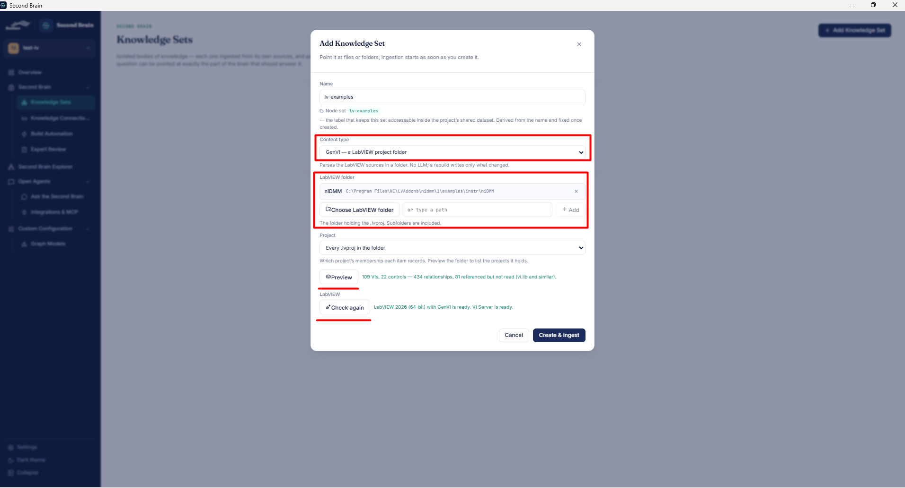
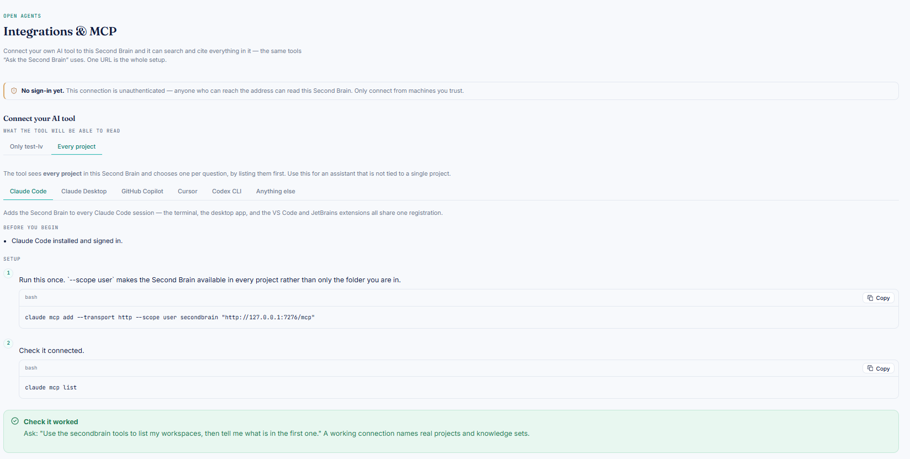

# 🔬 Create a GenVI Knowledge Set

👉 A GenVI knowledge set reads the VIs, controls and relationships in a LabVIEW project folder, so a coding agent can answer questions about that project through Second Brain.

> 💡 **Note:** Parsing needs no LLM. A rebuild writes only what changed.

---

## 🗺️ Overview

1. **Install the GenVI package:** install the `.vip` from the releases page using VIPM.
2. **Configure the LabVIEW version** in Second Brain **Settings**.
3. **Create a project**, then add a **GenVI knowledge set** to it and point it at your LabVIEW project folder.
4. **Use it with your AI coding agent** through MCP.

---

## ✅ Prerequisites

1. The **GenVI** package is installed. Download the `.vip` from the releases page (`x64` or `x86` to match your LabVIEW) and install it with [VIPM](https://www.vipm.io/).
2. 🪟 **LabVIEW is running** whenever you create the knowledge set or use _Ask Second Brain_.
3. The LabVIEW version is configured in **Settings** (see [Second Brain Settings](settings.md)). Pick a version marked **with GenVI**.

---

## ➕ 1. Add the knowledge set

First create a project to hold the knowledge set, or open an existing one. Then go to **Second Brain → Knowledge Sets → Add Knowledge Set**.

1. **Name:** enter a name, for example `lv-examples`.
2. **Content type:** choose **GenVI — a LabVIEW project folder**.
3. **LabVIEW folder:** click **Choose LabVIEW folder**, or type a path and click **Add**.
   - The folder must hold the `.lvproj`. Subfolders are included.
   - You can add more than one folder.
4. **Project:** leave it on _Every .lvproj in the folder_, or pick a single project.
5. Click **Preview** to see what will be ingested. For example: _109 VIs, 22 controls, 434 relationships, 81 referenced but not read (vi.lib and similar)_.
6. Under **LabVIEW**, click **Check again**. Wait for _"LabVIEW (64-bit) with GenVI is ready. VI Server is ready."_ ✅
7. Click **Create & ingest**. Ingestion starts as soon as the set is created.

---

## 🔌 2. Connect a coding agent

Go to **Open Agents → Integrations & MCP**.

1. Under _What the tool will be able to read_, choose a single project or **Every project**.
2. Select your tool: Claude Code, Claude Desktop, GitHub Copilot, Cursor, Codex CLI, or Anything else.
3. Follow the setup steps shown for your tool.

---

## 🧪 3. Check that it works

Ask your agent:

> Use the secondbrain tools to list my workspaces, then tell me what is in the first one.

A working connection names your real projects and knowledge sets. ✅

You can then ask about the LabVIEW project, for example _"What does the niDMM example do?"_

> 💡 **Note:** Keep LabVIEW running while you ask.
