# 🧪 GenVI Unit Tester

👉 Generate, run and review unit tests for the VIs in your LabVIEW project. **You choose the VIs. The agent writes the tests. LabVIEW runs them. You read the report.**

> 💡 **Note:** Only generating tests uses your reasoning model. Running tests works without it.

---

## 🗺️ Overview

1. **Install Second Brain and the GenVI package** from the [Releases](https://github.com/solitontech/secondbrain-ga/releases) page.
2. **Configure the reasoning model** in Settings.
3. **Create a GenVI knowledge set** for your LabVIEW project.
4. **Generate, run and review** the tests in GenVI Unit Tester.

---

## ✅ Prerequisites

1. **Second Brain is installed.** Download the latest build for your platform from the [Releases](https://github.com/solitontech/secondbrain-ga/releases) page.
2. **The GenVI package is installed.** Download the `.vip` from the same page (`x64` or `x86` to match your LabVIEW) and install it with [VIPM](https://www.vipm.io/).
3. 🪟 **LabVIEW and the GenVI client are installed and running.** Tests run in the LabVIEW that is open on this PC. Do not run LabVIEW as administrator, and close any dialog boxes in LabVIEW.
4. **The reasoning model is configured in Settings.**
5. **A GenVI knowledge set is built from your project.**

---

## ⚙️ 1. Configure the reasoning model

Configuring the reasoning model in Settings is the first step to generate tests for LabVIEW projects.

1. Open **Settings** and fill in the **Reasoning Model** section.
2. Under **LabVIEW (GenVI)**, choose your LabVIEW version.
3. Click **Save and restart services**.

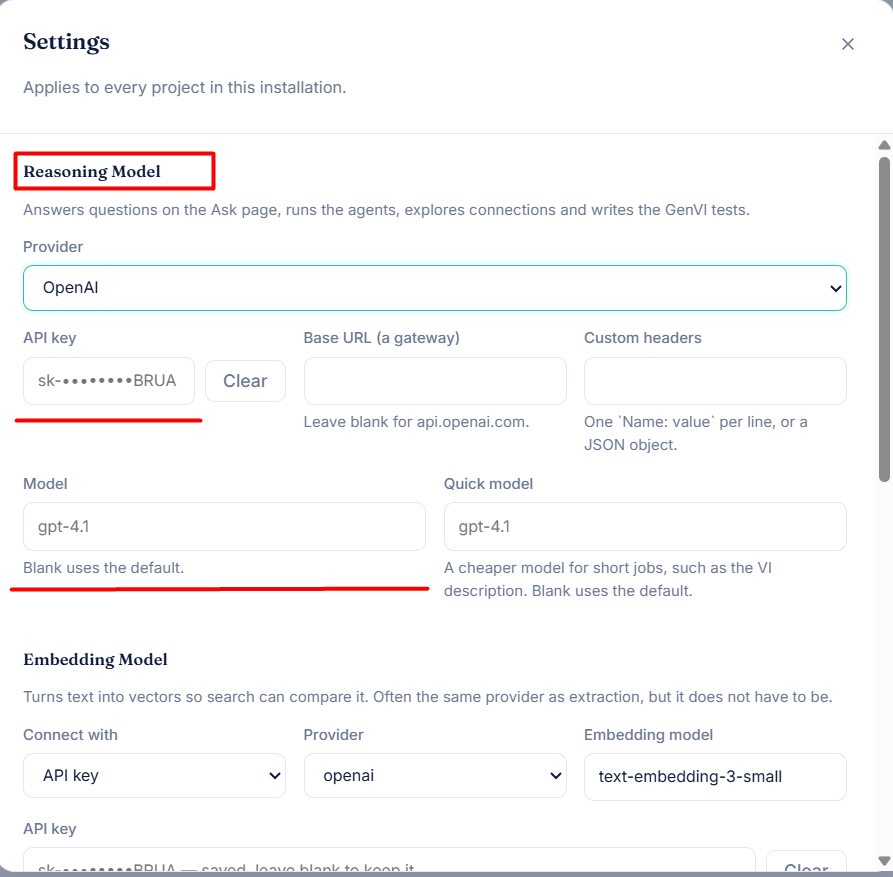

---

## 🔬 2. Check LabVIEW and GenVI

🪟 **Windows only.** Ensure LabVIEW and the GenVI client are installed and running.

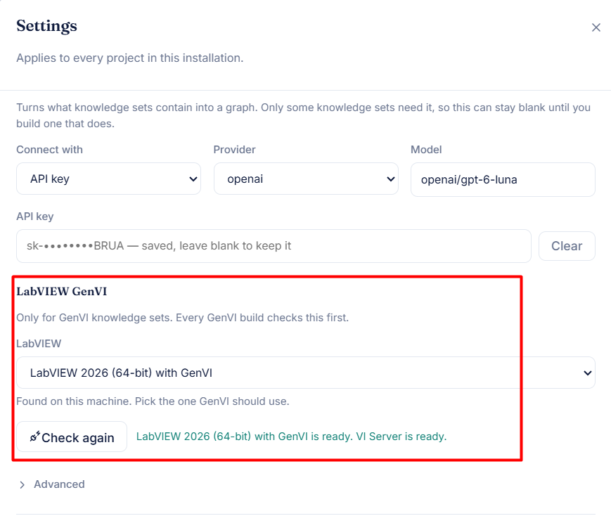

---

## ➕ 3. Create a GenVI knowledge set

In **Knowledge Sets**, create a set of type **GenVI**, choose the folder that holds your `.lvproj`, and build it. Wait until it is ready.

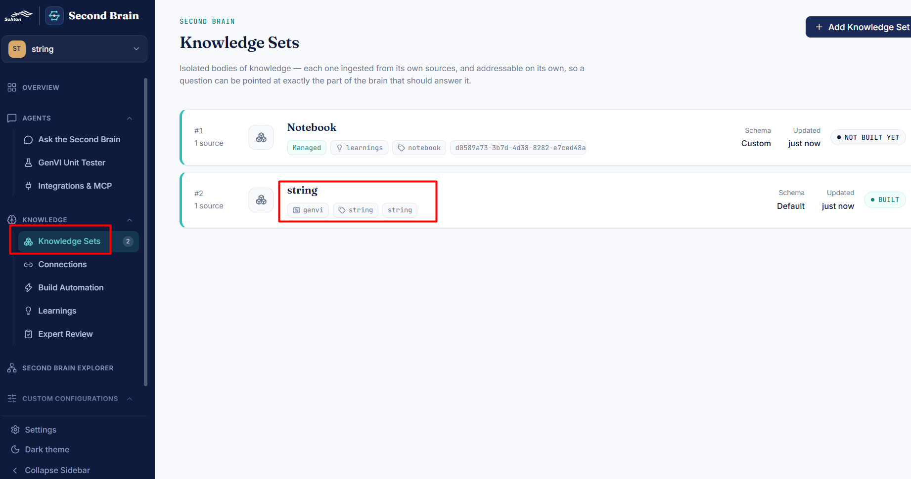

---

## 🧪 4. Generate tests

1. Navigate to **GenVI Unit Tester** and choose the LabVIEW project for which tests need to be generated.
2. Make sure the **LabVIEW** and **Reasoning** badges are green. If not, configure them in Settings.

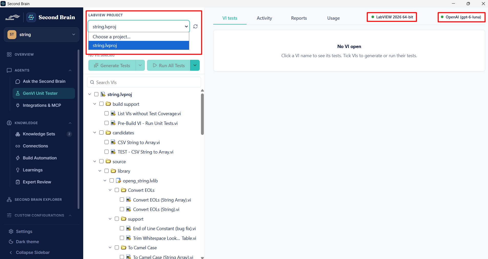

3. Select the VI and tick its check box to generate tests for it.

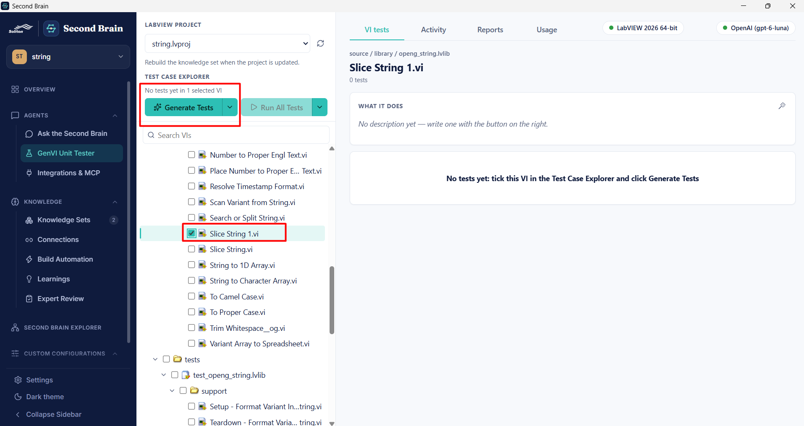

4. Click **Generate Tests**, then open the **Activity** tab to follow the status. Allow roughly 30 seconds to 2 minutes per VI.

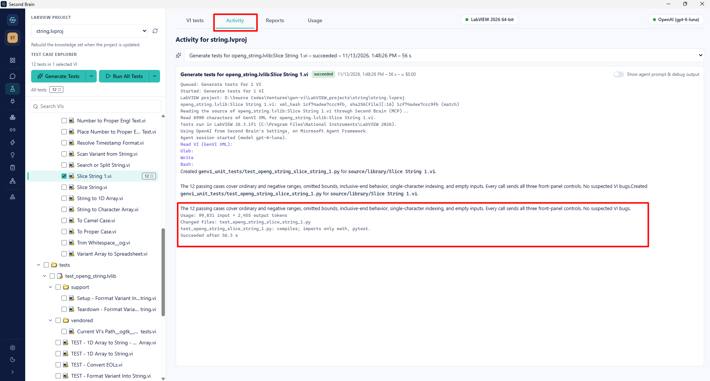

5. Check the tests generated and what each test case contains. Read the cases before you trust them: do the expected values match what the VI should do?

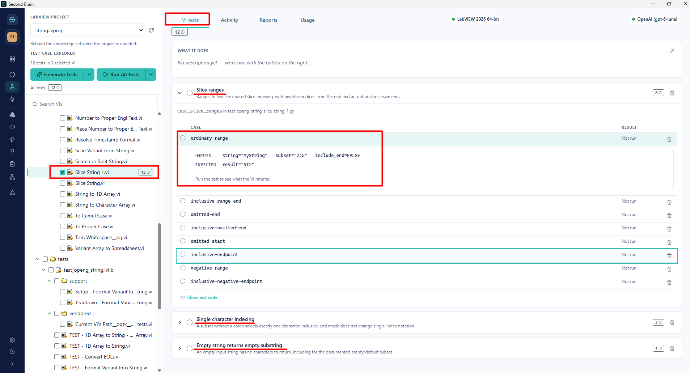

---

## ▶️ 5. Run the tests

1. Make sure the VI is selected, then click **Run All Tests**. To run only the selected VIs, click the small arrow next to it and choose **Run Selected Tests**.

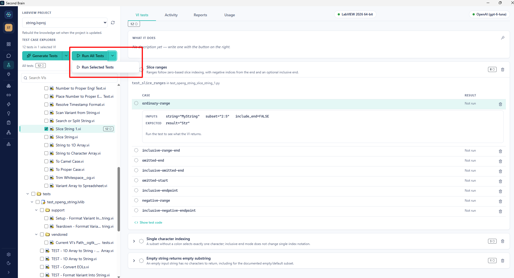

2. Follow progress in **Activity**. When the run is complete, the results can be viewed on the VI's page.

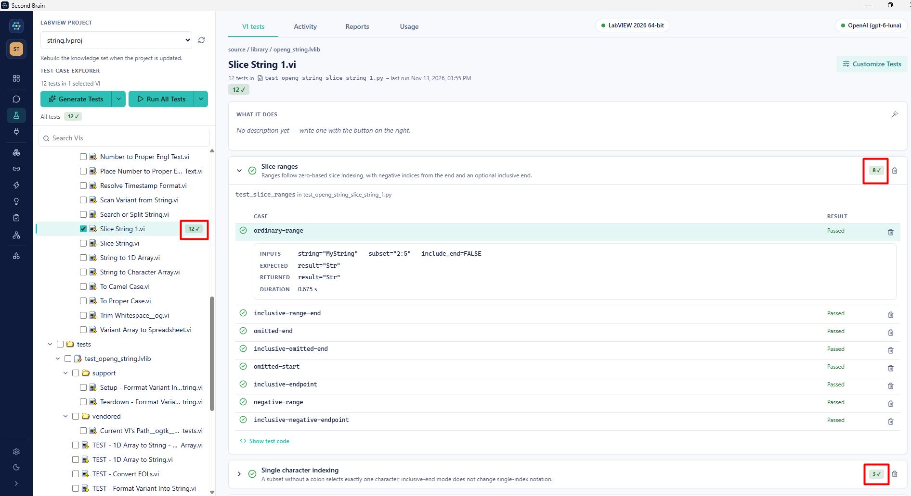

---

## ✏️ 6. Customize the tests

Click **Customize Tests** on the right side of the VI's page to add or change test cases. You can give plain-language instructions, for example to correct a wrong expected value.

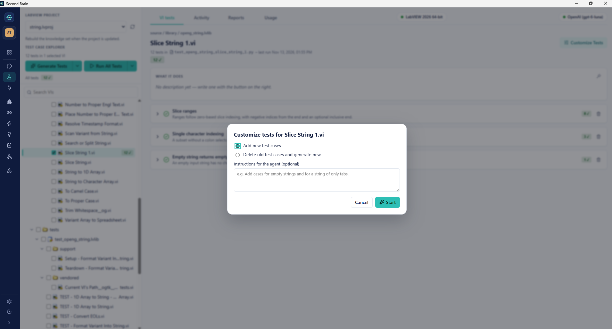

---

## 📊 7. Read the reports and usage

- **Reports:** the results of each test run are listed under the **Reports** tab.

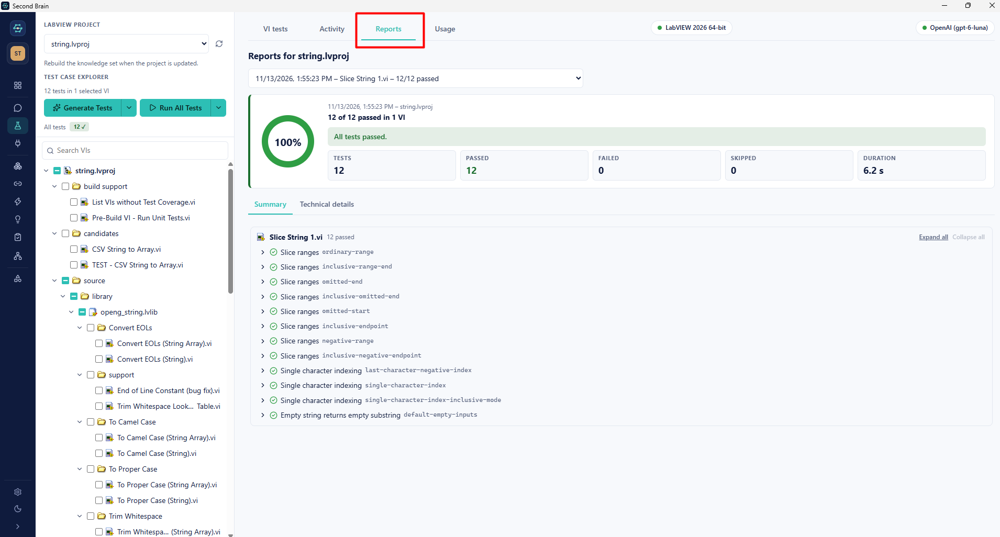

- **Usage:** open the **Usage** tab to see the cost of generating the test cases.

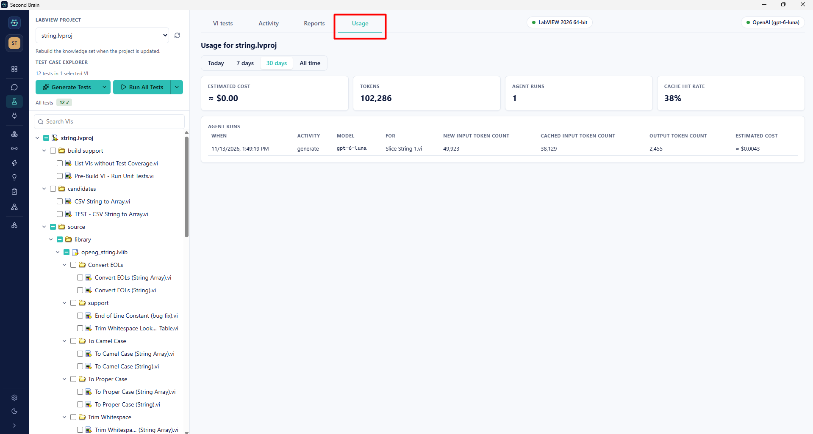

> 💡 **Note:** The cost shown is an estimate. Your AI provider's own console is the real bill.

---
