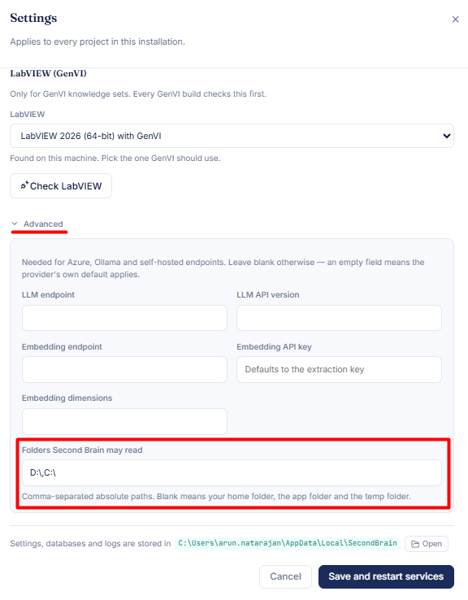
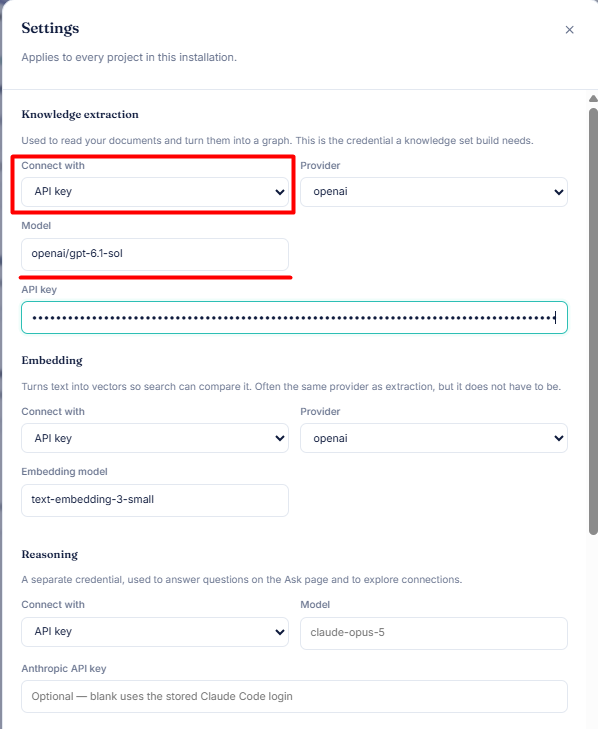
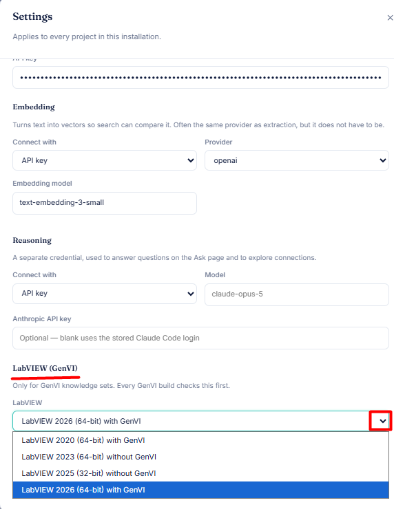
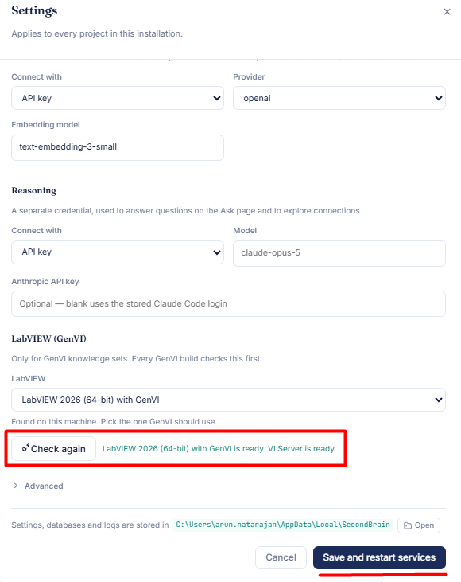

# ⚙️ Second Brain Settings

👉 Open **Settings**. These apply to every project in this installation.

---

## 📁 1. Folders Second Brain may read

1. Expand **Advanced**.
2. Enter absolute paths in **Folders Second Brain may read**, comma-separated (e.g. `D:\,C:\`).

> 💡 **Note:** Blank means your home folder, the app folder and the temp folder.

---

## 🔑 2. API key for knowledge set creation

Under **Knowledge extraction**:

- **Connect with:** API key
- **Provider / Model:** choose your provider and model
- **API key:** paste your key

> 💡 **Note:** Embedding and Reasoning have their own credentials. Reasoning is optional; blank uses the stored Claude Code login.

---

## 🔬 3. LabVIEW configuration

🪟 **Windows only.** ℹ️ Only needed for GenVI knowledge sets.

1. Under **LabVIEW (GenVI)**, open the dropdown.
2. Select a version marked **with GenVI**.
3. Click **Check LabVIEW**. Wait for *"LabVIEW is ready. VI Server is ready."* ✅

---

## 💾 4. Apply your changes

Finally, click **Save and restart services**. Changes to any of the settings above only take effect after this.
